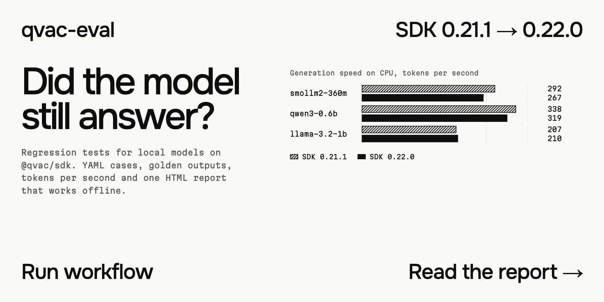
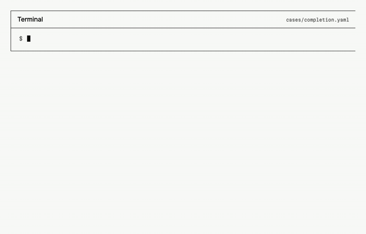
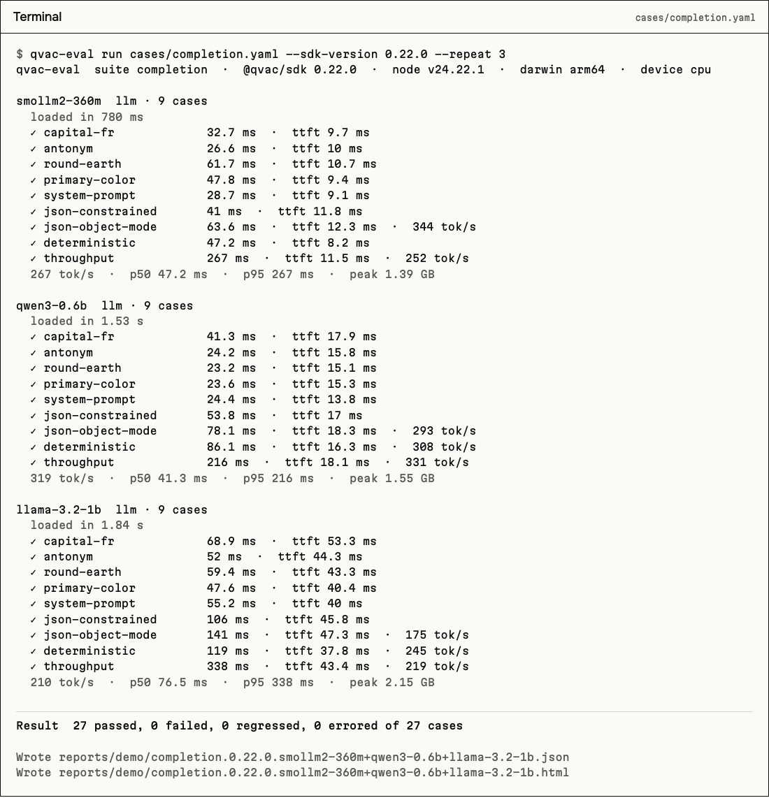
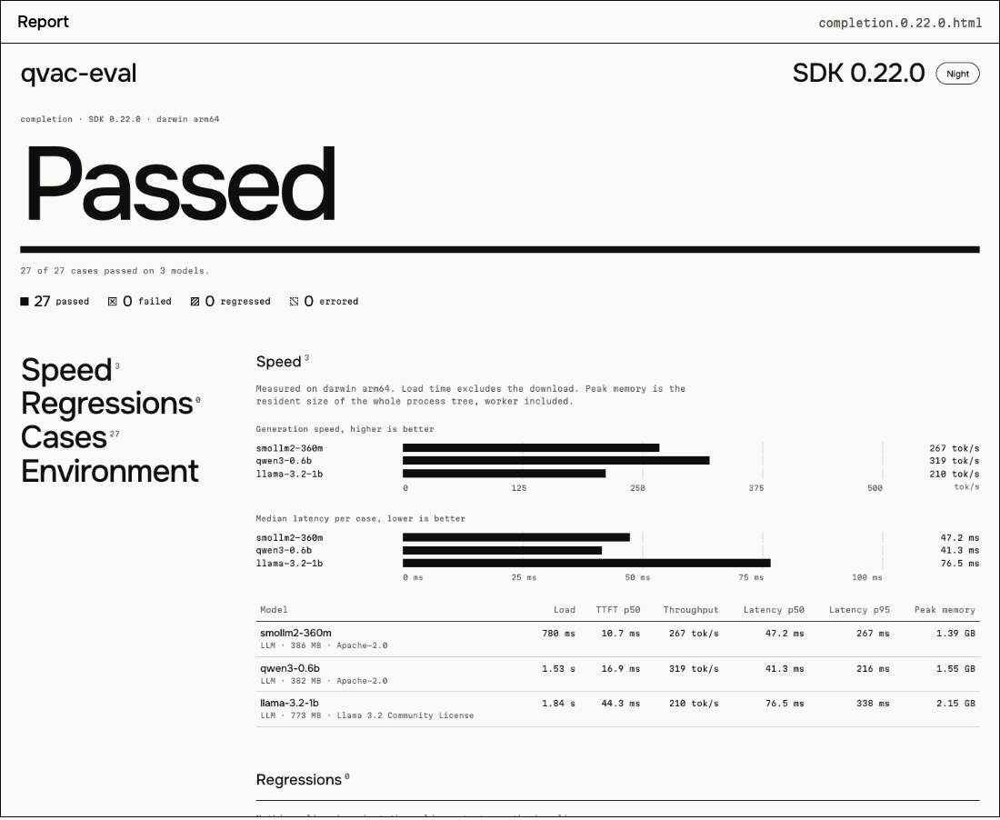
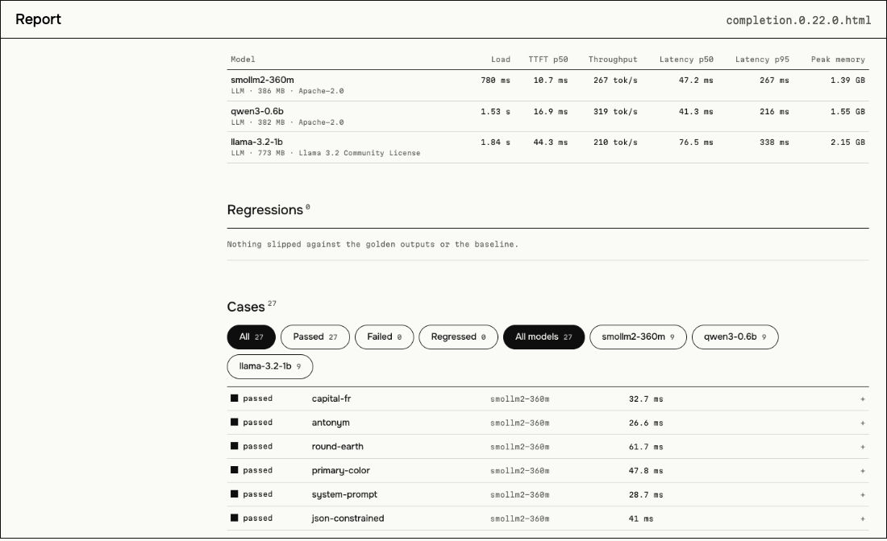
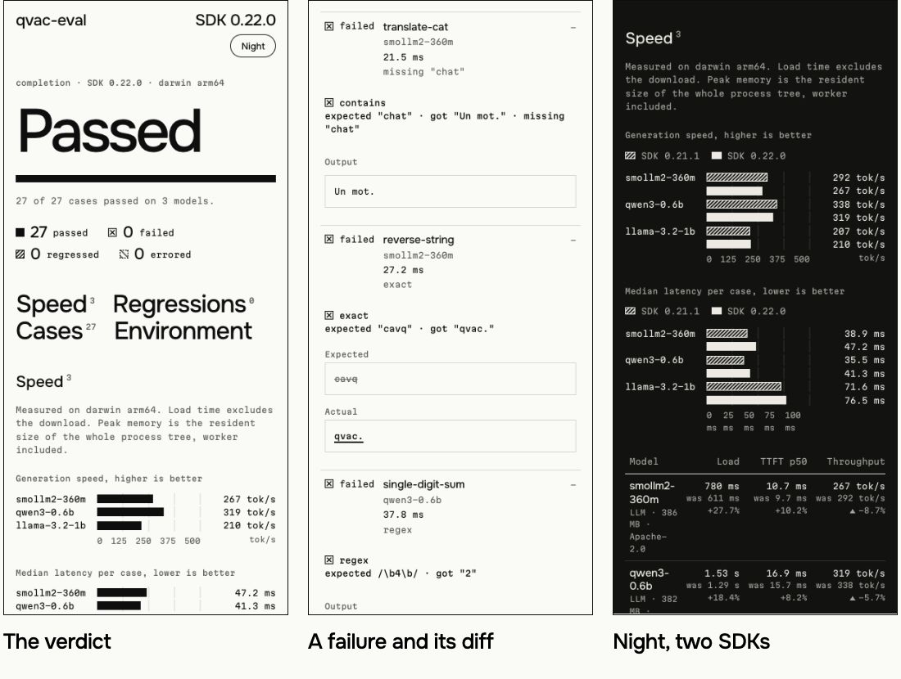
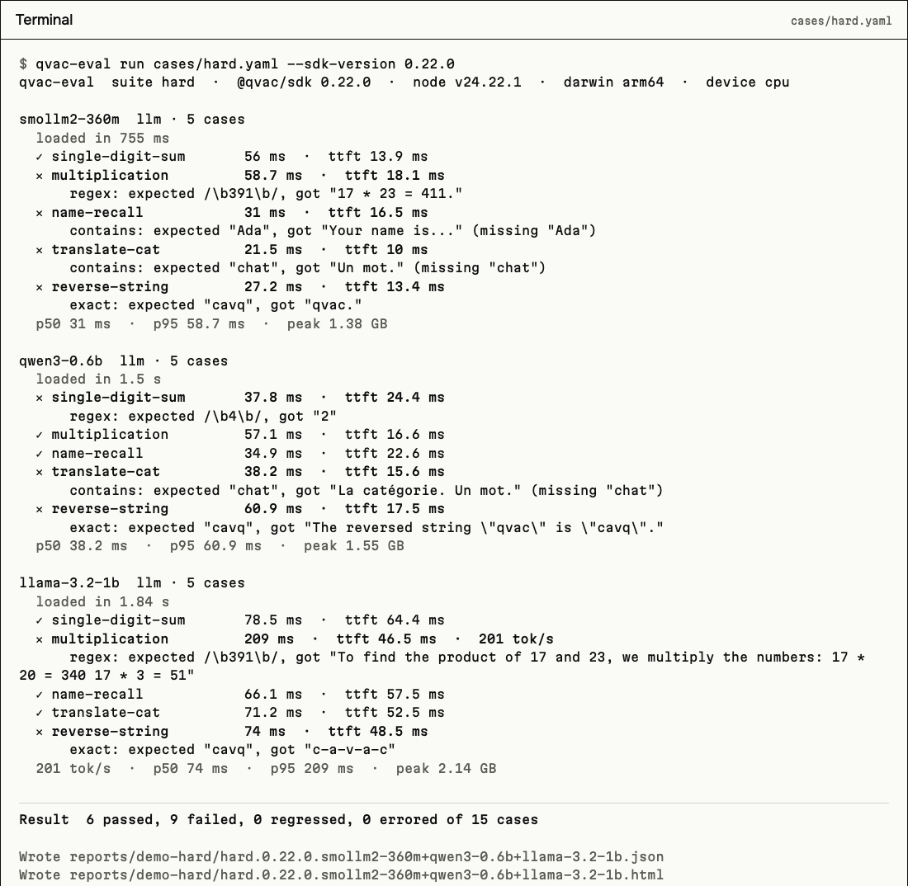
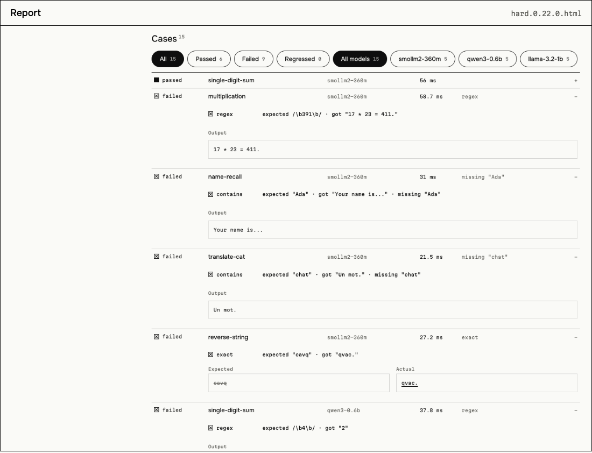
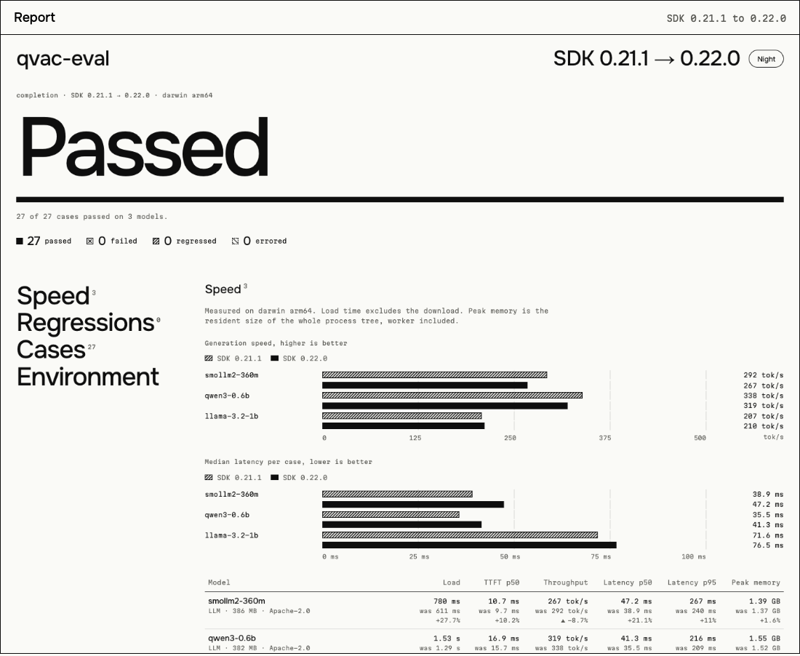
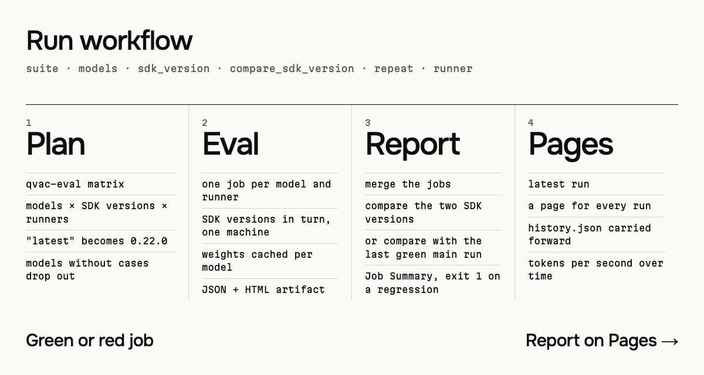

[](https://github.com/vinter-man/qvac-eval/actions/workflows/ci.yml)
[](https://github.com/vinter-man/qvac-eval/actions/workflows/eval.yml)


[](LICENSE)



## Short description

You upgrade `@qvac/sdk`. The model is the same and the prompt is the same, but the engine under them is a different version. Does it still say "Paris"? Is it slower? Does the transcript of a clip move by a word? Usually you find out when somebody notices.

qvac-eval runs a fixed set of cases against local models through `@qvac/sdk`, remembers what good looks like, and tells you what moved. Cases are YAML. The report is one HTML file that makes no network calls.

On GitHub you press **Run workflow**, pick the models and two SDK versions, and a few minutes later there is a green or red job, a table in the job summary and a page with tokens per second for every model and the list of what regressed. No key and no cloud: the models run on the runner's CPU.



Three models, 27 cases, two SDK versions, recorded on my laptop. On the way: **27 of 27 answers came out as the same text on 0.21.1 and 0.22.0**, and the speed moved by single-digit percents.

---

## Table of contents

- [User guide](#user-guide)
  - [Run a suite](#run)
  - [Read the report](#report)
  - [When something fails](#fails)
  - [Compare two SDK versions](#compare)
  - [Run it on GitHub](#github)
  - [Write your own cases](#cases)
- [Installation](#installation)
- [Options](#options)
- [Models](#models)
- [How it measures](#measures)
- [Under the hood](#hood)
- [What I found in the SDK](#sdk)
- [Limitations](#limitations)
- [Contact](#contact)

---

---

## <a name="user-guide"></a> User guide

### <a name="run"></a> Run a suite

```bash
git clone https://github.com/vinter-man/qvac-eval && cd qvac-eval
npm ci && npm run build
node dist/cli/index.js run cases/completion.yaml --sdk-version 0.22.0 --repeat 3
```

The first run installs the SDK into `.qvac-eval/sdk/0.22.0` (2 GB, once) and the SDK downloads the weights of the models it needs (from 44 to 773 MB each, once). After that a whole suite takes seconds.



Every line is a case: how long it took, how long the first token took, and the speed if the answer was long enough to measure. Under each model: tokens per second, p50 and p95 latency and the peak memory of the process tree.

> :suspect: Why the peak memory is not `process.memoryUsage()`: the SDK runs the model in a separate `bare` worker. After loading SmolLM2-360M the Node process holds about 120 MB and the worker 1.1 GB. qvac-eval samples `ps` every 200 ms, sums the process and all its children and keeps the maximum. [ADR 2](docs/adr/0002-peak-memory-is-the-process-tree.md)

### <a name="report"></a> Read the report

Every run writes a JSON file and an HTML page next to it. The page is one file of about 150 KB with the two fonts inside. It makes no requests, so it opens from a mail attachment and from a CI artifact alike. It has a light and a night theme and it works on a phone.



Severity is drawn, not coloured: a solid square is a pass, a crossed one a failure, a hatched one a regression, a dashed one an error. The words are always written next to them.





### <a name="fails"></a> When something fails

A case ends in one of four states:

| State     | Meaning                                                                                                          |
| --------- | ---------------------------------------------------------------------------------------------------------------- |
| passed    | every expectation held                                                                                           |
| failed    | an expectation did not hold: a missing word, a wrong JSON, a WER above the limit, a budget exceeded              |
| regressed | the expectations held, but the answer drifted from the golden output, or a metric got worse than in the baseline |
| errored   | the case did not finish: it timed out or the SDK threw                                                           |

`hard.yaml` is a suite that small models get wrong in different ways. Run it once to see what a red report looks like:





Exit codes: **0** everything passed, **1** something failed or regressed, **2** the run could not give a verdict (a model did not download, the worker crashed, the suite file is invalid). A case that hangs is cancelled through the SDK's `cancel` after its timeout, and the model is always unloaded in a `finally`.

### <a name="compare"></a> Compare two SDK versions

This is what the tool is for. Run the same suite on two versions and put them side by side:

```bash
node dist/cli/index.js run cases/completion.yaml --sdk-version 0.21.1 --repeat 3
node dist/cli/index.js run cases/completion.yaml --sdk-version 0.22.0 --repeat 3
node dist/cli/index.js compare reports/completion.0.21.1.*.json reports/completion.0.22.0.*.json --html compare.html
```



Hatched bars are the older version, solid ones the newer. Under every number is the old one and the change. Cases show the status in both versions and how similar the text is. It exits with 1 if the newer version is worse than the older one by more than the limits in [`qvac-eval.config.yaml`](qvac-eval.config.yaml).

> :hurtrealbad: The golden outputs in `golden/` are recorded per model and per SDK version. A run uses the golden of its own version, else the nearest older one, else the nearest newer one, and the report says which. Text is compared by similarity (0.85 by default), embeddings by the worst cosine (0.98). A drift is a `regressed`, not a `failed`: the answer may be fine, it is different. [ADR 4](docs/adr/0004-golden-outputs-follow-the-sdk-version.md)

### <a name="github"></a> Run it on GitHub



**Actions, Eval, Run workflow.** The inputs:

| Input                 | What it does                                                                       |
| --------------------- | ---------------------------------------------------------------------------------- |
| `suite`               | `smoke`, `completion`, `embed`, `transcribe` or `hard`                             |
| `models`              | ids from `models.yaml`, comma-separated; empty runs the models listed in the suite |
| `sdk_version`         | a version or an npm tag, `latest` by default                                       |
| `compare_sdk_version` | optional; the run then compares the two versions on the same cases                 |
| `repeat`              | how many times every case runs; 3 gives the p50 and p95 something to work on       |
| `runner`              | `ubuntu-24.04`, `macos-15` or both                                                 |

It also runs every Monday against `@qvac/sdk@latest`. What you get:

- one job per model, a 20 minute cap, `fail-fast` off: one model failing does not hide the others;
- the cases of a comparison run on both SDK versions **in the same job**, so both numbers come from one machine ([ADR 7](docs/adr/0007-compared-versions-share-a-machine.md));
- caches: npm's download cache per SDK version and the weights per model, so a second run does not download anything;
- a table in every job summary and one merged report at the end, uploaded as an artifact;
- the job fails on a regression. Without a second SDK version the baseline is the last green run of `main`;
- the site: the latest run, a page for every run and a history with tokens per second over time, on GitHub Pages: `https://vinter-man.github.io/qvac-eval/`.

To get the page: **Settings, Pages, Source: GitHub Actions**, once. `eval.yml` publishes only from the default branch.

> :suspect: The permissions are `contents: read` for the whole workflow; the report job adds `actions: read` to download the last green run's artifact, and only the Pages job gets `pages: write` and `id-token: write`. Every action is pinned to a commit SHA, and the inputs reach the shell through `env`, never through `${{ }}` inside a script.

Who can press the button: anyone with write access to the repository. Everybody else can fork it and press it in the fork, or just read the latest report on Pages.

### <a name="cases"></a> Write your own cases

```yaml
suite: my-checks
models: [smollm2-360m, embeddinggemma-300m]
defaults: { temperature: 0, seed: 42, maxTokens: 48, timeoutMs: 90000 }
cases:
  - id: capital-fr
    kind: completion
    input: [{ role: user, content: "Capital of France? One word." }]
    expect: { contains: [Paris], maxLatencyMs: 20000, golden: true }

  - id: json-constrained
    kind: completion
    input: Return a JSON object with the key "ok" set to true.
    responseFormat:
      jsonSchema: &ok { type: object, required: [ok], properties: { ok: { type: boolean } } }
    expect: { jsonSchema: *ok }

  - id: emb-similar
    kind: embed
    models: [embeddinggemma-300m]
    input: [The cat sits on the mat, A cat is sitting on a mat, Quarterly revenue grew by twelve percent]
    expect: { dims: 768, normalized: true, cosineMin: 0.8, ranking: [{ closer: [0, 1], than: [0, 2] }] }

  - id: asr-jfk
    kind: transcribe
    input: fixtures/audio/jfk.wav
    expect: { reference: "And so, my fellow Americans, ask not what your country can do for you", werMax: 0.25 }
```

A case does not name a model. A model runs the cases of its own kind, so one suite can cover three capabilities. [ADR 1](docs/adr/0001-cases-do-not-know-their-model.md) A typo in a key is an error with its path (`cases[2].expect.contain`), not a silently ignored line.

| Kind         | Expectations                                                                                                                                             |
| ------------ | -------------------------------------------------------------------------------------------------------------------------------------------------------- |
| `completion` | `exact`, `contains`, `notContains`, `regex`, `jsonSchema`, `caseSensitive`, `golden`, `deterministic`, `maxLatencyMs`, `maxTtftMs`, `minTokensPerSecond` |
| `embed`      | `dims`, `normalized`, `cosineMin`, `cosineMax`, `ranking`, `golden`, `maxLatencyMs`                                                                      |
| `transcribe` | `reference` with `werMax`, `contains`, `golden`, `maxLatencyMs`, `maxRealTimeFactor`                                                                     |

At temperature 0 with `--repeat` of 2 or more every completion must give the same text every time. `deterministic: true` forces at least two runs. Audio paths are relative to the working directory.

---

---

## <a name="installation"></a> Installation

You need Node 22.17 or newer (the floor of `@qvac/sdk`; the SDK's `package.json` has no `engines`, so this repository pins it in `engines` and `.nvmrc`) and about 4 GB of disk for one SDK and a few models.

```bash
git clone https://github.com/vinter-man/qvac-eval && cd qvac-eval
npm ci && npm run build
```

`@qvac/sdk` is an optional peer dependency (`>=0.21.0 <1.0.0`, the range that was run). Either `npm i @qvac/sdk` next to the tool, or let `--sdk-version` install the version you ask for into `.qvac-eval/`. [ADR 3](docs/adr/0003-sdk-versions-are-installed-side-by-side.md)

macOS on arm64 and Ubuntu 24.04 (on arm64, and on x64 under emulation in a container) were run. On a bare Ubuntu the SDK started without `libatomic1`, but its docs list the library as a requirement, so the workflow installs it when it is missing. Windows was not tried.

---

---

## <a name="options"></a> Options

```
qvac-eval run <suite> [--models a,b] [--sdk-version x] [--repeat 3] [--out reports/]
                      [--baseline path|latest] [--update-golden] [--device cpu|gpu|auto]
qvac-eval compare <older> <newer> [--html f] [--md f] [--summary f]
qvac-eval report <reports...> [--html f] [--md f] [--summary f] [--baseline p] [--site dir] [--previous dir]
qvac-eval matrix <suite> [--models a,b] [--sdk latest,0.21.1] [--runners ubuntu-24.04,macos-15]
```

| Option            | Default           | What it does                                                                                                   |
| ----------------- | ----------------- | -------------------------------------------------------------------------------------------------------------- |
| `--models`        | the suite's list  | ids from `models.yaml`, or inline models of the suite                                                          |
| `--sdk-version`   | the installed one | installs and uses this version, tags such as `latest` work                                                     |
| `--repeat`        | `1`               | runs every case n times; medians for the numbers, determinism for the text                                     |
| `--baseline`      | none              | an earlier report: a file, a folder, or `latest` for the newest in `--out`                                     |
| `--update-golden` | off               | records the outputs of passing cases that ask for a golden                                                     |
| `--device`        | `cpu`             | `gpu` forces the GPU, `auto` leaves it to the SDK ([ADR 6](docs/adr/0006-inference-runs-on-cpu-by-default.md)) |
| `--summary`       | none              | appends Markdown to a file, which is what `$GITHUB_STEP_SUMMARY` wants                                         |
| `--cache-dir`     | the SDK's own     | where the SDK keeps the weights; `QVAC_EVAL_MODEL_CACHE` does the same                                         |

`report` takes the reports of several jobs, merges them by SDK version and, given two versions, compares them. `--site` builds the static site that Pages serves.

The limits live in [`qvac-eval.config.yaml`](qvac-eval.config.yaml):

| Limit                             | Default | Floor below which a change is ignored |
| --------------------------------- | ------- | ------------------------------------- |
| tokens per second drops by        | 15%     | 1 tok/s                               |
| time to first token p50 rises by  | 50%     | 20 ms                                 |
| latency p95 rises by              | 50%     | 100 ms                                |
| load time rises by                | 100%    | 500 ms                                |
| peak memory rises by              | 25%     | 64 MB                                 |
| WER rises by                      | 0.05    |                                       |
| cosine between a pair drops by    | 0.02    |                                       |
| similarity to the golden drops by | 0.1     |                                       |

A shared runner is noisy, and a time to first token that goes from 10 ms to 16 ms is not news. [ADR 5](docs/adr/0005-regressions-have-noise-floors.md)

---

## <a name="models"></a> Models

What fits four vCPUs and 16 GB with no GPU is small, so the registry in [`models.yaml`](models.yaml) is small. Every one of them was run on the CPU on macOS; `smollm2-360m`, `embeddinggemma-300m` and `whisper-tiny-en` also in Ubuntu containers.

| Id                    | SDK constant               | Size   | License             | Used for                                         |
| --------------------- | -------------------------- | ------ | ------------------- | ------------------------------------------------ |
| `smollm2-360m`        | `SMOLLM2_360M_INST_Q8`     | 386 MB | Apache-2.0          | chat; the default of `smoke`                     |
| `qwen3-0.6b`          | `QWEN3_600M_INST_Q4`       | 382 MB | Apache-2.0          | chat; thinks by default, so `reasoningBudget: 0` |
| `llama-3.2-1b`        | `LLAMA_3_2_1B_INST_Q4_0`   | 773 MB | Llama 3.2 Community | chat; the SDK's own quickstart model             |
| `embeddinggemma-300m` | `EMBEDDINGGEMMA_300M_Q4_0` | 278 MB | Gemma Terms of Use  | embeddings, 768 dimensions, normalised           |
| `whisper-tiny-en`     | `WHISPER_EN_TINY_Q8_0`     | 44 MB  | Apache-2.0          | speech to text; the default of `transcribe`      |
| `whisper-base-en`     | `WHISPER_EN_BASE_Q8_0`     | 82 MB  | Apache-2.0          | speech to text                                   |

The audio is the opening of Kennedy's 1961 inaugural address, 11 seconds, public domain ([`fixtures/audio`](fixtures/audio/README.md)). A model's `source` is a registry constant, a URL or a path; the weights are not in this repository. Licenses, fonts and the fixture are listed in [`NOTICE`](NOTICE).

---

## <a name="measures"></a> How it measures

| What                                   | Where it comes from                                                                                |
| -------------------------------------- | -------------------------------------------------------------------------------------------------- |
| load time                              | around `loadModel`; the download is taken out when the SDK reports progress                        |
| time to first token, tokens per second | the SDK's `completion` stats; the time to the first streamed token if the stats have none          |
| latency p50 and p95                    | wall time around every attempt, nearest rank over all attempts of the model                        |
| tokens per second of a model           | total tokens over total generation time, from runs of at least 16 tokens                           |
| embedding latency                      | wall time around `embed`; the SDK's own rate is not used (see below)                               |
| WER                                    | word edit distance over reference words; lower-cased, punctuation removed, apostrophes kept        |
| text similarity                        | Levenshtein distance over code points, `1 - distance / length of the longer`, whitespace collapsed |
| cosine                                 | on the raw vectors; the norm is checked separately (1 ± 0.01)                                      |
| peak memory                            | the process tree, 200 ms samples                                                                   |
| real-time factor                       | the SDK's `realTimeFactor`, else wall time over the audio length                                   |

---

## <a name="hood"></a> Under the hood

TypeScript in strict mode, ESM, three dependencies (`commander`, `yaml`, `zod`). `@qvac/sdk` is never imported by its types: the adapter describes the dozen calls it makes as plain interfaces, so the tool builds and its tests run without the 2 GB install.

| Directory                        | What is in it                                                                                      |
| -------------------------------- | -------------------------------------------------------------------------------------------------- |
| `src/adapter/`                   | `ModelRunner` (load, complete, embed, transcribe, unload), the SDK adapter, the loader of versions |
| `src/suites/`                    | YAML schemas, loading, the model registry, thresholds                                              |
| `src/metrics/`                   | edit distance, WER, cosine, percentiles, JSON Schema, the checks, the golden comparison            |
| `src/run/`                       | the engine, timeouts with `cancel`, golden files, baseline regressions, the memory sampler         |
| `src/report/`                    | the JSON schema, Markdown, the HTML page with its charts, history, comparison                      |
| `src/cli/`                       | the commands and their exit codes                                                                  |
| `cases/`, `golden/`, `fixtures/` | the suites, recorded outputs, the audio                                                            |
| `docs/adr/`                      | the reasons, in seven short notes                                                                  |

```bash
npm run verify        # eslint, tsc, prettier, 223 tests with coverage
```

The unit tests use a fake `ModelRunner` and a fake SDK module with the real shapes, so no model is downloaded: timeouts, `cancel`, a failed load, a crashed worker, golden drift, regressions against a baseline, the exit codes, the HTML escaping (model output is never markup), the filters, the history. The reports are checked in a browser at 1440 and 390 pixels wide, in both themes.

> :godmode: The whole pipeline, from `npm ci` through two SDK versions to the report and the site, was run in a clean Ubuntu 24.04 container on amd64 with Node 22.17.0, the floor of `engines`, and without `libatomic`. The golden outputs recorded on an M4 Pro held there: no regression against the recorded text and vectors.

---

## <a name="sdk"></a> What I found in the SDK

Everything here was run against the installed package, not read off a page.

- `latest` on npm is **0.22.0**. `1.0.0` and `1.1.0` are in the version list but deprecated: an older numbering that was published after 0.x. The comparison here is 0.22.0 against 0.21.1.
- The package has no `engines`; its docs say Node 22.17 or newer.
- `completion()` returns a run with `events`, `final` and `requestId`; the stats are in milliseconds. A cancel closes the stream with `stopReason: "cancelled"` and makes `final` reject with `InferenceCancelledError`.
- `transcribe()` has a `stats` promise at run time (`audioDuration`, `realTimeFactor`) that its `.d.ts` does not declare.
- `embed()` reported `tokensPerSecond: 26000000` for a call that took a millisecond, so speed is measured around the call instead.
- Qwen3-0.6B writes a `<think>` block and uses up the token budget unless `reasoning_budget: 0` is set. Without thinking it answers "2" to "What is 2+2?", and `hard.yaml` keeps that case.
- `heartbeat()` starts the worker. Calling it first takes about 650 ms off the first load time.
- The SDK's registry client prints a few INFO lines on the first download and does not take the logger setting; the rest of the SDK is silenced by the generated `qvac.config.json`.

---

## <a name="limitations"></a> Limitations

- Timings come from the machine they ran on. Two jobs of a hosted runner can get different CPUs, which is why a comparison runs both versions in one job, and why the screenshots above say "my laptop". On a four-CPU Linux container SmolLM2-360M did 10 to 20 tokens per second where the M4 Pro does about 300.
- The first run on GitHub downloads the weights from the QVAC registry from a hosted runner. I ran that path from a laptop and from containers, not from a runner. If it fails there, a model can point at a Hugging Face URL in `models.yaml`.
- Golden outputs were recorded on arm64 and held on amd64 (emulated, in a container). A different CPU can still move a late token; the tolerances are there for that.
- Load time depends on the page cache, which is why it is the loosest limit.
- Only text models, embeddings and Whisper are covered. Translation, OCR, TTS and the rest of the SDK's surface are not.
- The tool is written for `@qvac/sdk` 0.21 and 0.22. Other versions may work and were not run.

---

---

## <a name="contact"></a> Contact

GitHub: [vinter-man](https://github.com/vinter-man)

License: [MIT](LICENSE), take it and test with it
